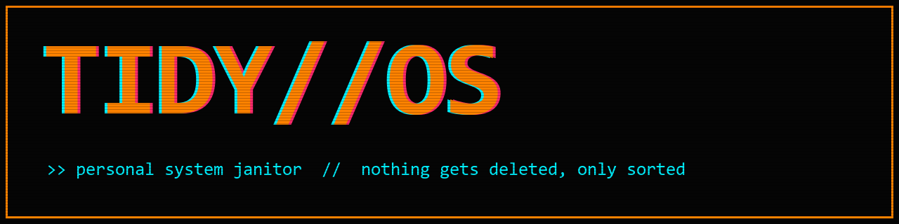
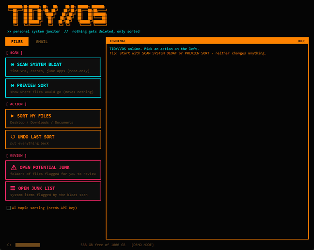
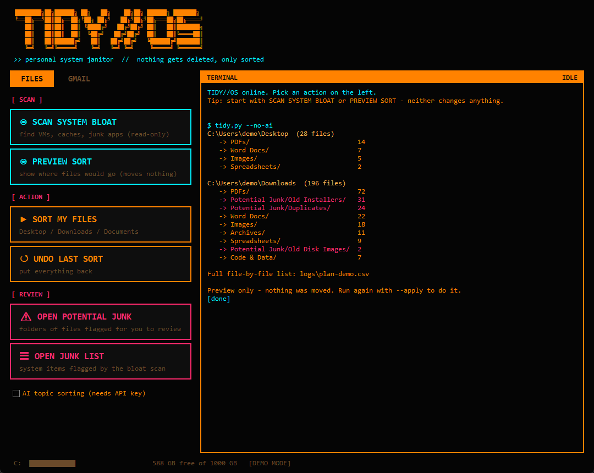
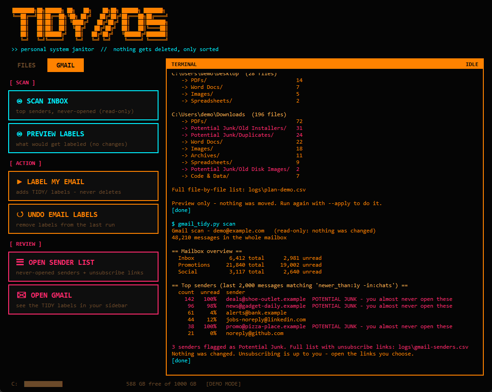
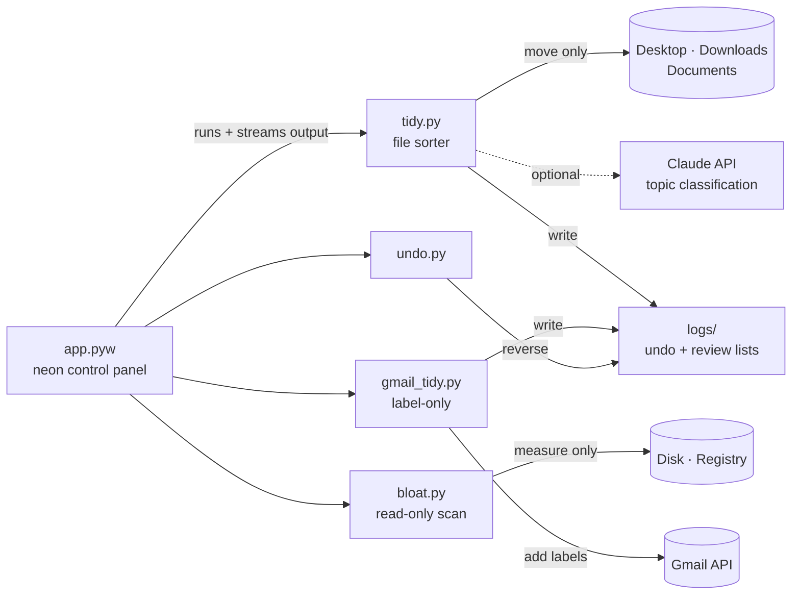

<p align="center">
  
</p>

<p align="center">
  
  
  
  
</p>

<p align="center"><b>A neon control panel that sorts your PC and your Gmail — and never deletes a thing.</b></p>

<p align="center">
  
</p>

---

## ⚡ What it does

| | Feature | How |
|---|---|---|
| 🗂️ | **Sorts loose files** | Desktop, Downloads and Documents into `PDFs/`, `Spreadsheets/`, `Images/`… or by **topic** (Taxes, Receipts, Resumes) with optional AI |
| ⚠️ | **Flags Potential Junk** | Duplicates (by SHA-1), installers older than 90 days, stale ISOs and unfinished downloads go to a `Potential Junk/` folder for *you* to review |
| 💾 | **Finds system bloat** | Forgotten VM disks, dev caches, old Windows Update files, stale mail caches, known bloatware — reported, never touched |
| ✉️ | **Labels your Gmail** | `TIDY/Receipts`, `TIDY/Jobs & Career`, `TIDY/Security`… plus a list of senders you never open, with their unsubscribe links |
| ↺ | **Undoes everything** | Every file move and every Gmail label is logged and reversible with one click |

## 🛡️ The safety promise

TIDY//OS was built around one rule: **nothing gets deleted — only sorted.**

- **Preview first.** Every action has a dry-run button that shows exactly what would happen.
- **Undo logs.** Each run writes a log *as it goes*, so even a crash halfway through can be reversed.
- **No delete calls.** The file scripts only move; the Gmail script only *adds labels* — it never trashes, archives or unsubscribes.
- **Read-only scans.** The bloat and inbox scans measure and report. You decide what to remove.
- **Your data stays local.** File sorting runs entirely on your PC. Your Gmail sign-in token is stored outside synced folders.

<p align="center">
  
  
</p>

## 🚀 Quick start

```bash
git clone https://github.com/ShadowHertz/tidy-os.git
cd tidy-os
py -m pip install -r requirements.txt
pythonw app.pyw
```

Want to look around first without touching anything? Run it in **demo mode** with fake data:

```bash
pythonw app.pyw --demo
```

<details>
<summary><b>Command line usage</b></summary>

```bash
py tidy.py                  # preview how files would be sorted
py tidy.py --apply          # sort them
py undo.py                  # put the last sort back
py bloat.py                 # read-only disk bloat report
py gmail_tidy.py scan       # read-only inbox report
py gmail_tidy.py sort       # preview Gmail labels
py gmail_tidy.py sort --apply
py gmail_tidy.py undo
```
</details>

<details>
<summary><b>Connecting Gmail (one-time, ~5 minutes)</b></summary>

Gmail access uses your *own* private Google Cloud app, so no third party ever sees your mail.

1. In [Google Cloud Console](https://console.cloud.google.com), create a project and enable the **Gmail API**.
2. Under **Google Auth Platform**, set audience to **External** and add your Gmail address as a **test user**.
3. Create an OAuth client of type **Desktop app** and download the JSON.
4. Save it as `credentials.json` in this folder, then click **SCAN INBOX**.

Google will warn that the app isn't verified — that's expected for a personal app. Click **Continue**.
</details>

<details>
<summary><b>AI topic sorting (optional)</b></summary>

Tick **AI topic sorting** to have Claude read the first ~1,500 characters of each PDF/DOCX and pick a topic folder. Requires an [Anthropic API key](https://console.anthropic.com) in the `ANTHROPIC_API_KEY` environment variable. Results are cached, so re-running a preview is free. Without a key, documents are sorted by file type.
</details>

## 🧠 How it works



Everything is configurable in [`config.json`](config.json): which folders to sort, file categories, junk rules, and Gmail label rules (plain Gmail search queries).

## 🗺️ Roadmap

- [ ] Scheduled weekly tidy with a summary notification
- [ ] Archive option for reviewed Potential Junk emails
- [ ] AI-suggested file names for scanned documents
- [ ] Portable `.exe` build

## 💡 Why I built it

My Downloads folder had grown to 20 GB of installers and duplicate PDFs, and I had 32 GB of virtual machines I'd forgotten about quietly syncing to OneDrive. Every cleanup tool I tried either wanted to delete things for me or wanted my email data. So I built one that does neither.

## 📄 License

[MIT](LICENSE)
